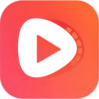
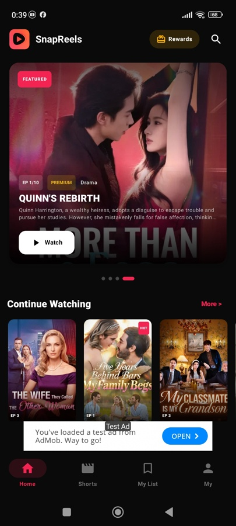
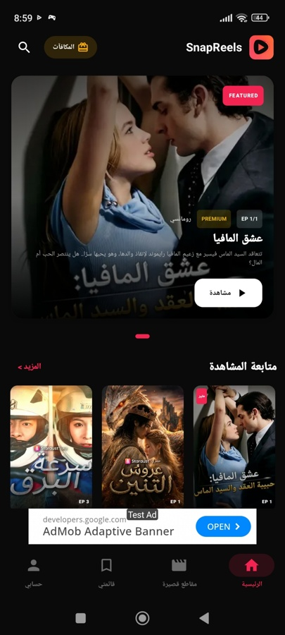
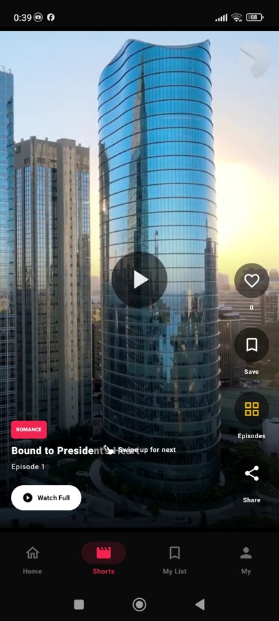
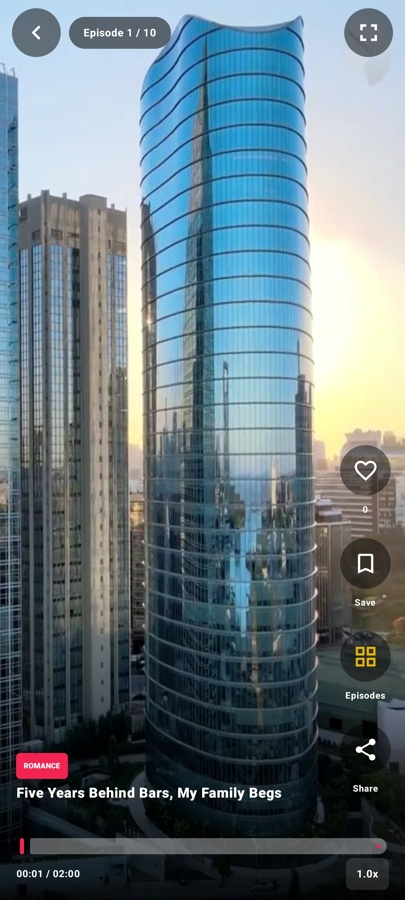
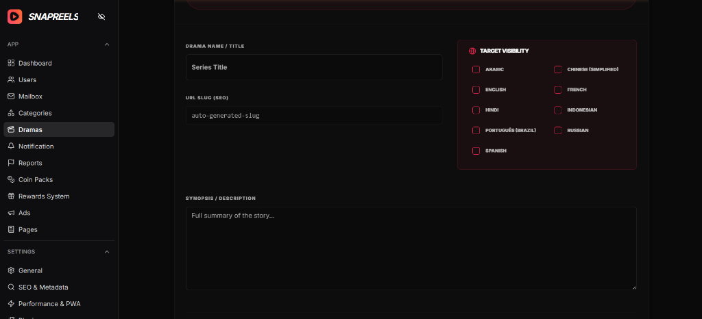
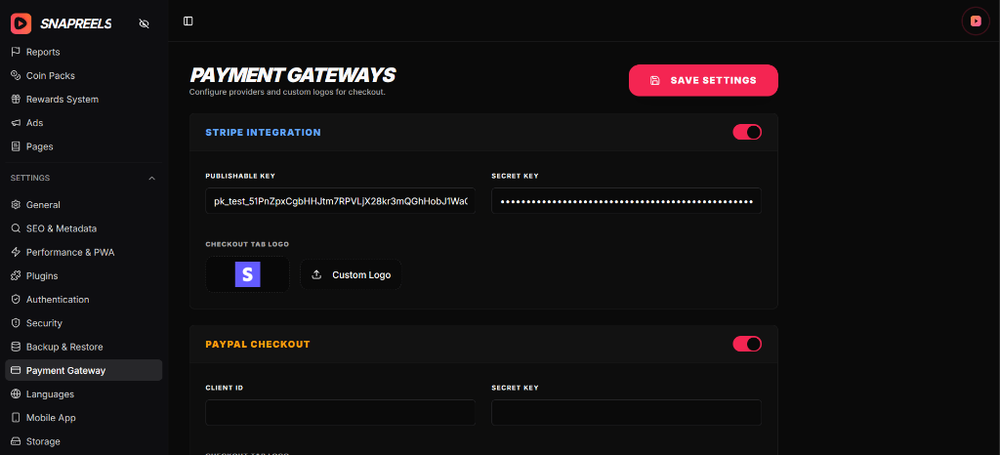

  
  <h1>🎬 SnapReels Platform</h1>
  
<strong>The Ultimate Short Video & Drama Streaming Ecosystem</strong>

  
  
  
  
  

 

Welcome to **SnapReels**, a robust and premium Short Video & Drama streaming platform, featuring a high-performance **Web Application**, a powerful **Admin Panel**, and a fully native **Android App**. SnapReels brings the ultimate cinematic experience to your users, packed with cutting-edge features.

---

## ✨ Key Features

### 📱 Premium Native Android App
* **Instant Shorts Playback:** 0ms startup delay with background pre-caching.
* **ExoPlayer Integration:** Top-tier video playback, HLS (`.m3u8`) & `.ts` support.
* **Cinematic UI:** Immersive edge-to-edge layout, dynamic ambient lighting.
* **Robust Deep Linking:** Watch links launch seamlessly directly in-app.

### 💻 Modern Next.js Web Platform
* **Ultra-Fast Streaming:** Video proxying, HLS support, and seamless chunking.
* **AI-Powered Metadata:** Integrated with Gemini, OpenAI, and Groq for auto-generating drama metadata.
* **Multi-Language & Subtitles:** Built-in `.srt` & `.vtt` handling with dynamic WebVTT conversion.
* **Viral Social Sharing:** Dynamic OpenGraph cards when sharing on WhatsApp, Telegram, X/Twitter.

### 🛠️ Comprehensive Admin Panel
* **Bulk Episodes Uploader:** Drag-and-drop mass uploads with automatic sequential numbering.
* **Multi-Gateway Monetization:** Stripe, PayPal, Razorpay, Flutterwave, PhonePe, Cashfree, and PayU.
* **Ad Integration:** Google AdMob App Open Ads to maximize publisher revenue.
* **Brand Protection:** Easy video player watermark overlay configuration.

---

## 📸 Platform Previews

### Native Mobile Experience

  
  
  
  

### Powerful Admin Dashboard

  
  

---

## 🚀 Getting Started

The platform consists of three main parts:
1. **`code/`** - Next.js Fullstack Web App & Admin Panel.
2. **`Android App/`** - Native Kotlin Android Source Code.
3. **`Documontation/`** - Setup guides and full project documentation.

### Prerequisites
* **Node.js**: v18 or v20 LTS
* **Database**: MongoDB 5.0+
* **Mobile**: Android Studio Ladybug or later

Please refer to `Documontation/index.html` for a complete step-by-step installation guide.

---

  <i>Built for high performance, scale, and modern video streaming demands.</i>

